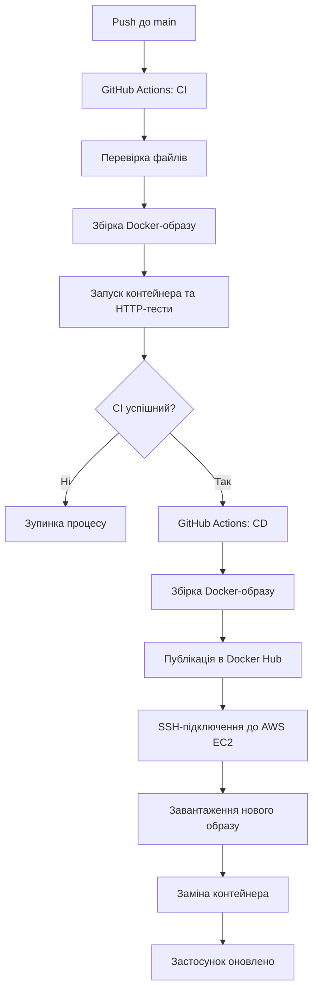

# Mini DevOps Dashboard

## 1. Опис проєкту

Mini DevOps Dashboard — це простий вебзастосунок, створений за допомогою HTML, CSS та JavaScript.

Проєкт демонструє використання контейнеризації, автоматизації CI/CD, публікації Docker-образів та керування хмарною інфраструктурою.

### Основні можливості

- Цифровий годинник із відображенням поточного часу.
- Інтерактивний лічильник натискань.
- Перемикання світлої та темної теми.
- Кнопка перевірки працездатності інтерфейсу.
- Адаптивний користувацький інтерфейс.

## 2. Використані технології

- HTML5, CSS3, JavaScript
- Docker та Nginx
- Git та GitHub
- GitHub Actions
- Docker Hub
- AWS EC2
- Terraform

## 3. Структура проєкту

```text
Final-project/
├── .github/
│   └── workflows/
│       ├── ci.yml
│       └── deploy.yml
└── students/
    └── Pyatkov_Volodymyr/
        ├── .github/workflows/
        │   ├── ci.yml
        │   └── deploy.yml
        ├── infra/
        │   ├── main.tf
        │   ├── variables.tf
        │   ├── outputs.tf
        │   └── .terraform.lock.hcl
        ├── src/
        │   ├── index.html
        │   ├── style.css
        │   └── script.js
        ├── Dockerfile
        ├── .dockerignore
        ├── .gitignore
        └── README.md
```

Каталог `.github/workflows/` у корені репозиторію містить GitHub Actions workflows, які автоматично виконуються GitHub.

## 4. Локальне встановлення та запуск

### Необхідні інструменти

- Git
- Docker

### Крок 1. Клонування репозиторію

```bash
git clone https://github.com/EndermanElectro121/Final-project.git
cd Final-project/students/Pyatkov_Volodymyr
```

### Крок 2. Створення Docker-образу

```bash
docker build -t mini-devops-dashboard .
```

### Крок 3. Запуск контейнера

```bash
docker run -d -p 8080:80 --name mini-dashboard mini-devops-dashboard
```

### Крок 4. Відкриття застосунку

Відкрийте у браузері:

```text
http://localhost:8080
```

### Крок 5. Зупинка контейнера

```bash
docker stop mini-dashboard
docker rm mini-dashboard
```

## 5. Налаштування GitHub Secrets

Для автоматичної публікації Docker-образу та розгортання застосунку використовуються такі секрети:

| Назва секрету | Призначення |
|---|---|
| `DOCKERHUB_USERNAME` | Ім'я користувача Docker Hub |
| `DOCKERHUB_TOKEN` | Токен доступу Docker Hub |
| `EC2_HOST` | Публічна IP-адреса або DNS-ім'я EC2 |
| `EC2_USER` | Ім'я користувача для SSH-підключення |
| `EC2_SSH_KEY_B64` | Приватний SSH-ключ у форматі Base64 |

Секрети додаються в розділі:

**GitHub → Settings → Secrets and variables → Actions.**

**Важливо:**

- Не додавайте паролі, токени та приватні SSH-ключі до репозиторію.
- Не публікуйте файли `.env` та приватні ключі.
- Зберігайте конфіденційні дані в GitHub Secrets.
- Не виводьте значення секретів у журналах GitHub Actions.

## 6. Автоматизація CI/CD

Для автоматизації перевірки та розгортання застосунку використовується GitHub Actions.

### Continuous Integration (CI)

Workflow CI запускається після push до гілки `main` або створення Pull Request із цільовою гілкою `main`.

Основні етапи:

1. Отримання коду з репозиторію.
2. Перевірка наявності файлів застосунку.
3. Створення Docker-образу.
4. Запуск тестового Docker-контейнера.
5. Перевірка доступності HTML, CSS та JavaScript через HTTP-запити.

### Continuous Deployment (CD)

Workflow CD автоматично запускається після успішного виконання CI для гілки `main`.

Основні етапи:

1. Отримання перевіреної версії коду.
2. Авторизація в Docker Hub.
3. Створення Docker-образу.
4. Публікація образів із тегами `latest` та ідентифікатором commit.
5. Підключення до AWS EC2 через SSH.
6. Завантаження нового Docker-образу.
7. Заміна попереднього контейнера.
8. Запуск оновленого контейнера.

Після розгортання застосунок доступний за адресою:

```text
http://13.51.200.227
```


### Схема роботи CI/CD



## 7. Керування інфраструктурою за допомогою Terraform

Terraform використовується для автоматизації створення та налаштування ресурсів AWS.

Поточна конфігурація Terraform виконує такі завдання:

- Отримує інформацію про вже наявний EC2 instance.
- Створює AWS Security Group.
- Налаштовує вхідні правила SSH (порт 22) та HTTP (порт 80).
- Підключає створену Security Group до мережевого інтерфейсу наявного EC2.
- Надає вихідні параметри з інформацією про EC2 та Security Group.

**Примітка:** сам EC2 instance створений окремо та не керується Terraform у цій конфігурації.

### Основні команди Terraform

Команди виконуються в каталозі `infra`:

```bash
terraform init
terraform validate
terraform plan
terraform apply
```

Для перегляду ресурсів, якими керує Terraform:

```bash
terraform state list
```

Файли стану Terraform та файли змінних із конфіденційними даними не повинні додаватися до Git-репозиторію.

## 8. Мета проєкту

Метою проєкту є отримання практичних навичок роботи з DevOps-інструментами, зокрема контейнеризацією Docker, автоматизацією CI/CD, розгортанням застосунків у хмарному середовищі AWS та керуванням інфраструктурою за допомогою Terraform.
